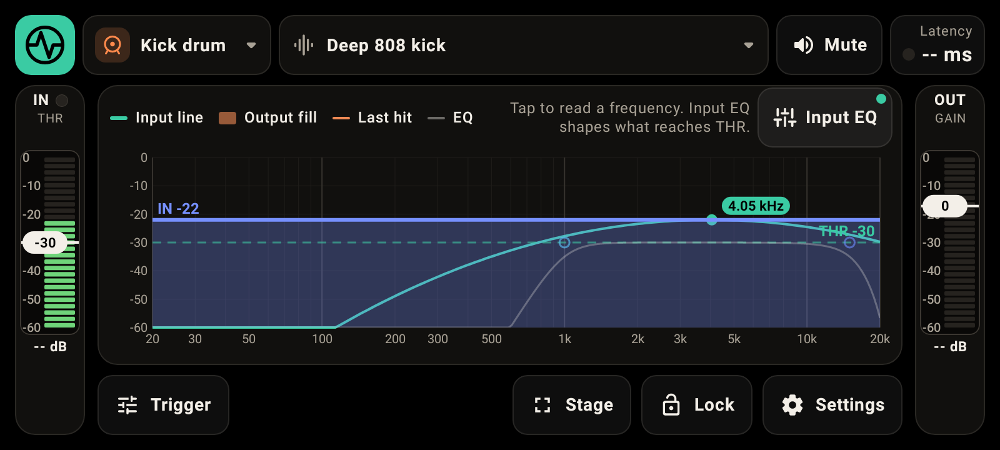
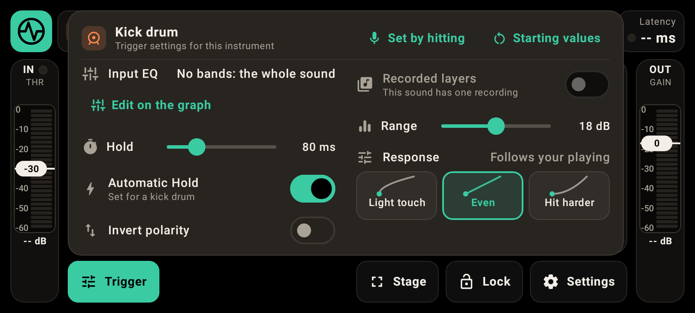
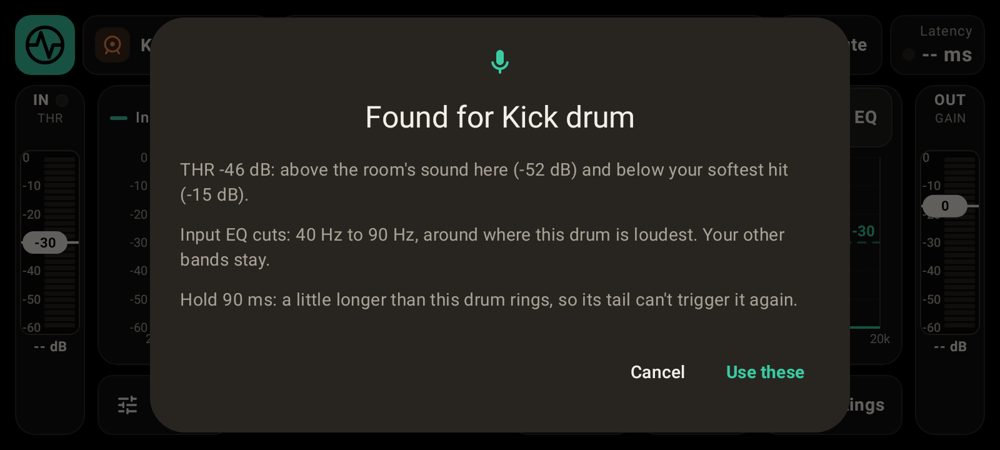
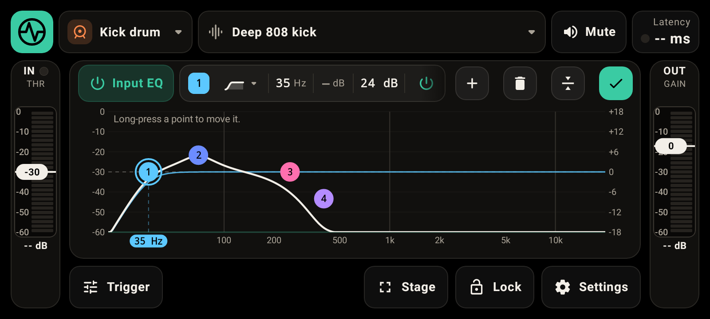
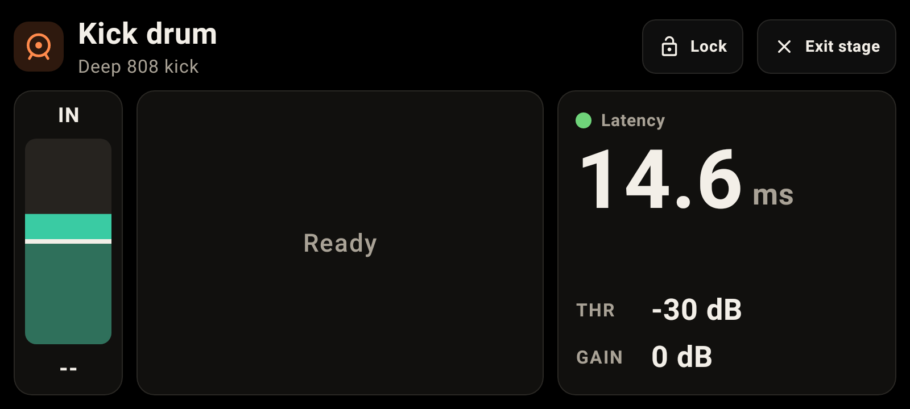
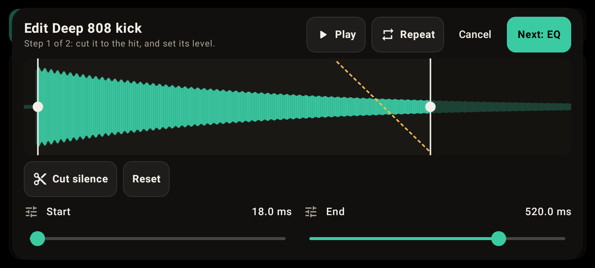
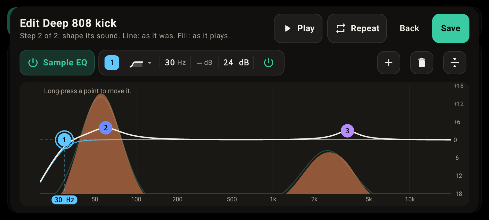
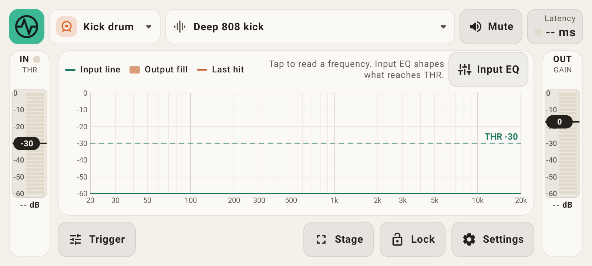

# DrumTrig

**DrumTrig** turns an Android phone into a live drum trigger. A mic on a drum (or an audio interface) goes in, and the phone plays the sound you chose, with as little delay as the phone can manage.

## What it does

- **Triggers from any mic.** Set the threshold (THR) on the IN meter, and shape the incoming sound with **Input EQ** on the graph, so only your drum fires the sound and the rest of the kit doesn't. The graph shows the sound as the trigger hears it.
- **Set by hitting.** Leave the drum alone for a moment, hit it a few times, and DrumTrig suggests the threshold, the Input EQ cuts and the hold time for you. Even without it, Hold sets itself for each kind of drum, and you can still change it.
- **Plays the sound you choose.** Bundled sounds, recorded drum kits (a free download inside the app), or your own samples. Every sample opens in the sample editor: trim it to the hit, fade the end, set its level, then shape it with its own EQ. The file itself is never changed.
- **Never clips.** However hard you hit and however high GAIN goes, a limiter turns only the loudest moments down, with no added delay.
- **Shows its delay.** The latency of every hit is measured and shown, and **Settings › Latency** explains where it comes from, with settings to bring it down.
- **Made for the stage.** A big-type Stage view, Lock so nothing changes mid-song by accident, Mute, a message if your audio device disconnects, and a light and a dark look.

| | |
|---|---|
|  |  |
| **Trigger menu**: when a hit counts and how it plays, kept per instrument. | **Set by hitting**: the threshold, the Input EQ cuts and the hold, found from the drum itself. |
|  |  |
| **Input EQ**: up to seven bands per instrument, shaping what reaches THR. | **Stage**: what matters mid-song, readable from behind the kit. |
|  |  |
| **Sample editor, step 1**: cut it to the hit and set its level. | **Sample editor, step 2**: shape its sound, with Repeat playing it while you change things. |

## Install or update DrumTrig

1. On your phone, open the **[latest release](https://github.com/fubulatu-lang/DrumTrig-Releases/releases/latest)**.
2. Download `DrumTrig-<version>.apk` and open it.
3. If Android asks, allow your browser or file manager to install apps.

Every release is signed with the same key, so a new version installs straight over the old one. Your instruments, samples, EQs and settings are kept.

DrumTrig also tells you when a new version is out. It checks this page each time it opens and sends nothing about you or your phone. When there is one, it asks as you open the app: **Update** downloads it and Android asks you to install it; **Ignore** skips that version. You can also check any time in **Settings › App › About & help**.

## Recorded drum sounds

The **sounds-…** releases hold the recorded drum sound pack. You don't need to download it here; DrumTrig fetches it when you tap **Download** in **Settings › Sound › Sound packs**. The app checks the file's fingerprint (SHA-256) before using it, so a changed or damaged file is refused.

The recorded sounds come from the DrumGizmo kits DRSKit, MuldjordKit and CrocellKit by the DrumGizmo team and Lars Muldjord ([drumgizmo.org](https://drumgizmo.org)). They are licensed [CC BY 4.0](https://creativecommons.org/licenses/by/4.0/), and were mixed to mono and trimmed for DrumTrig.

## What you need

- An Android phone or tablet running Android 8.0 or newer.
- A microphone or trigger: the phone's own mic works for trying it out. A USB audio interface, for both the mic and the sound out, gives the lowest delay.
